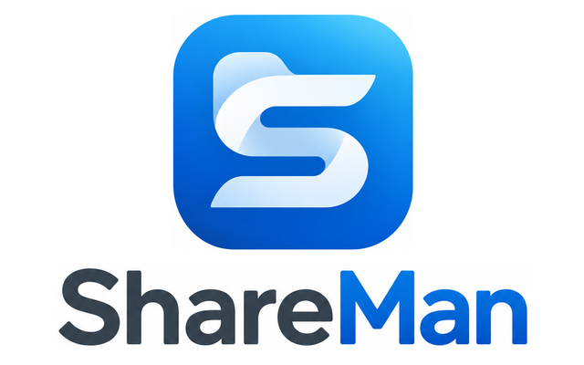

<p align="center">
  
</p>

<p align="center">
  <strong>Trouvez les partages NFS et SMB de votre réseau, et montez-les sur votre Mac en un clic.</strong><br>
  Sans <code>sudo</code>, sans configuration.
</p>

<p align="center">
  <a href="https://github.com/kawakode/shareBuddy/releases/latest"><strong>Télécharger</strong></a> ·
  <a href="https://kawakode.github.io/shareBuddy/">Site web</a> ·
  <a href="https://kawakode.github.io/shareBuddy/guide.html">Guide</a>
</p>

---

## En bref

- **Trouve** les serveurs de votre réseau local, via Bonjour et un scan rapide du sous-réseau. NFS d'abord, SMB ensuite.
- **Liste** les exports NFS et les partages SMB de chaque serveur.
- **Monte** le partage choisi dans `/Volumes`, comme « Se connecter au serveur » du Finder. Le trousseau est utilisé automatiquement.
- **Scan approfondi** pour les serveurs NFS discrets, qui ne s'annoncent pas et répondent mal au scan normal.

## Installation

1. Téléchargez le `.dmg` de la [dernière version](https://github.com/kawakode/shareBuddy/releases/latest).
2. Ouvrez-le et glissez ShareMan dans le dossier **Applications**.
3. Au premier scan, macOS demande l'accès au **réseau local** : acceptez, sinon aucun serveur ne sera trouvé.

Il faut macOS 13 Ventura ou plus récent.

## Utilisation

À gauche, les serveurs trouvés. À droite, les partages du serveur choisi, avec un bouton **Monter** (ou **Ouvrir** et **Démonter** s'il est déjà monté).

La barre d'outils permet de choisir NFS, SMB ou les deux, d'activer le scan approfondi et d'indiquer un sous-réseau précis (ex. `10.0.0.0/24`). Un serveur introuvable peut être ajouté à la main par son adresse IP.

## Ligne de commande

ShareMan existe aussi en ligne de commande, `shareman` :

```sh
shareman                                  # cherche les serveurs et liste leurs partages
shareman mount nas.local:/volume1/media   # monte un partage dans /Volumes
```

L'outil est fourni avec chaque version (`shareman-macos.zip`). Toutes les commandes et options sont dans le [guide](https://kawakode.github.io/shareBuddy/guide.html#ligne-de-commande).

## Compiler depuis les sources

Il faut Xcode ou les Command Line Tools (`xcode-select --install`).

```sh
scripts/build-app.sh --install   # ShareMan.app dans /Applications
swift build -c release           # l'outil shareman, dans .build/release/
swift test                       # les tests
```

## Problèmes courants

Voir le [guide](https://kawakode.github.io/shareBuddy/guide.html#problemes) : app bloquée par macOS, aucun serveur trouvé, « accès refusé » en NFS, partages SMB invisibles.

## Structure du projet

| Dossier | Contenu |
| --- | --- |
| `Sources/ShareManCore` | Le moteur : découverte, listes de partages, montage |
| `Sources/ShareManApp` | L'application SwiftUI |
| `Sources/shareman` | L'outil en ligne de commande |
| `Tests/ShareManCoreTests` | Les tests unitaires |
| `scripts/build-app.sh` | Fabrique `ShareMan.app` |
| `docs/` | Le site web et le guide (GitHub Pages, FR/EN) |
| `assets/branding/` | Icône et logos originaux |
